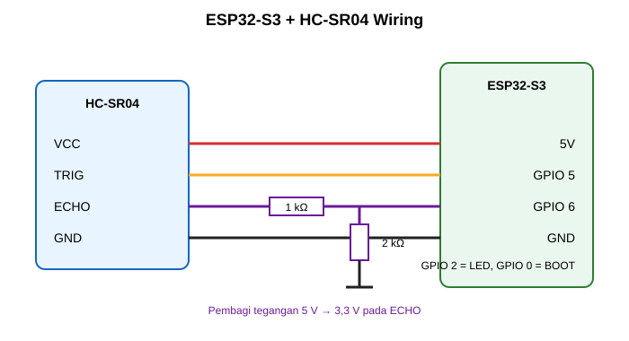

# Pin Mapping & Wiring



## Tabel koneksi

| HC-SR04 | ESP32-S3 | Catatan |
|---|---|---|
| VCC | 5V (pin VBUS/5V) | HC-SR04 butuh 5 V |
| GND | GND | |
| TRIG | GPIO 5 | output 3,3 V cukup untuk memicu |
| ECHO | GPIO 6 | **lewat pembagi tegangan** |

| Lainnya | GPIO | Catatan |
|---|---|---|
| LED | GPIO 2 | menyala saat WiFi terhubung |
| Tombol BOOT | GPIO 0 | tahan 5 detik = reset WiFi |

## Pembagi tegangan pada ECHO (penting)

Pin ECHO HC-SR04 mengeluarkan sinyal **5 V**, sedangkan GPIO ESP32-S3 hanya toleran **3,3 V**. Gunakan pembagi tegangan:

```
ECHO ──[ 1 kΩ ]──┬── GPIO 6
                 │
               [ 2 kΩ ]
                 │
                GND
```

Hasil: 5 V × 2k / (1k + 2k) ≈ 3,3 V.

> Alternatif: gunakan modul HC-SR04 versi 3,3 V (mis. RCWL-1601 / HC-SR04P).

## Berkas diagram

`wiring.svg` adalah diagram sederhana. Anda dapat menggantinya dengan diagram Fritzing sendiri (`wiring.png` atau `.fzz`) di folder ini.
